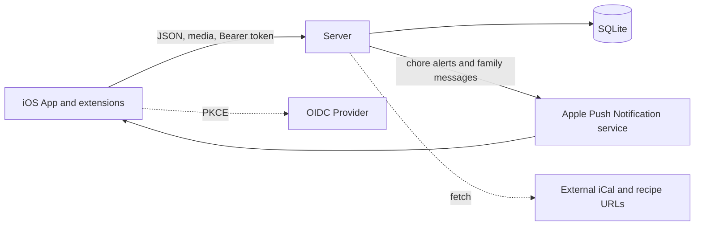
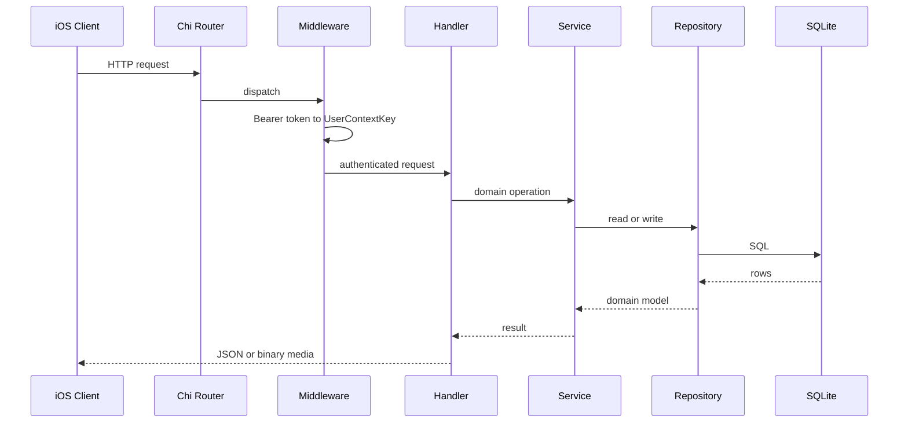
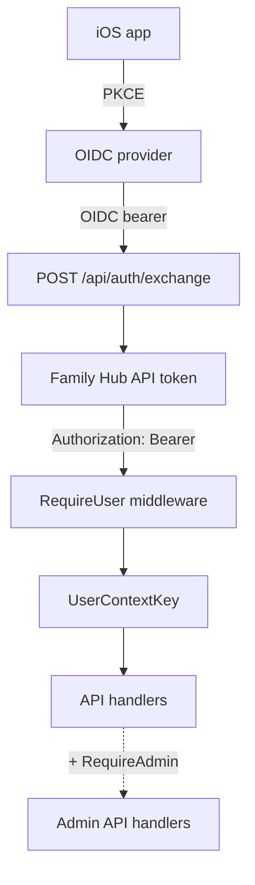

# Architecture

> System design, components, and request flow for Family Hub.

## Overview

Family Hub uses a Go API server and a SwiftUI iOS client. The iOS app handles
OIDC PKCE sign-in, exchanges the OIDC bearer token for a Family Hub API token,
and sends that token with authenticated requests. SQLite is the system of
record. iOS caches data in SwiftData and does not support offline writes.

## Diagram

## Components

| Component | Responsibility | Location |
|-----------|---------------|----------|
| HTTP server | Chi router, middleware, JSON and media handlers | `server/internal/server/`, `server/internal/handlers/` |
| Services | Business logic (recurrence, chore assignment, iCal fetch, recipe extraction, SSRF guard) | `server/internal/services/` |
| Repositories | Data access (interfaces and SQLite implementations) | `server/internal/repository/` |
| Migrations | Auto-run on startup | `server/internal/database/migrations/` |
| iOS app | SwiftUI client, extensions, shared API models | `ios/` |

## Request Flow

## Auth Flow

The iOS app uses the public OIDC client with PKCE. The server does not perform
browser login or store web sessions.

Public routes are `/health` and `/api/client-config`. The iOS app obtains an
API token through `POST /api/auth/exchange`. All other application routes
require a Bearer token, with admin authorization on management routes.

## SSRF Guard

Any handler that fetches an external URL on a user's behalf (iCal
subscriptions or recipe URL import) uses `services.ValidateExternalURL` and
`services.NewSafeHTTPClient` in `services/safenet.go`. This blocks private IP
ranges and non-HTTP(S) schemes.

## Data Model

See `server/internal/models/` for the full domain. SQLite migrations run during
server startup.

## External Dependencies

| Service | Purpose | Failure mode |
|---------|---------|--------------|
| OIDC provider | Sign-in for iOS clients | New sign-in and token exchange fail |
| External iCal feeds | Calendar subscriptions | Subscription becomes stale; existing events remain |
| Recipe URLs | Recipe import | Import returns an API error |

## Key Decisions

- **API server, native client.** The Go service exposes JSON and required media/file routes. iOS owns the user interface and OIDC browser handoff.
- **Public PKCE OIDC client.** No client secret is stored on the server.
- **Pure-Go SQLite.** `modernc.org/sqlite` removes the CGO toolchain dependency; tests use in-memory databases.
- **No offline writes on iOS.** SwiftData is a cache; mutations require connectivity.
- **Repository → Service → Handler.** Handlers avoid direct repository access when business logic belongs in a service.
- **Migrations run on startup.** Deployment does not require a separate migration step.
