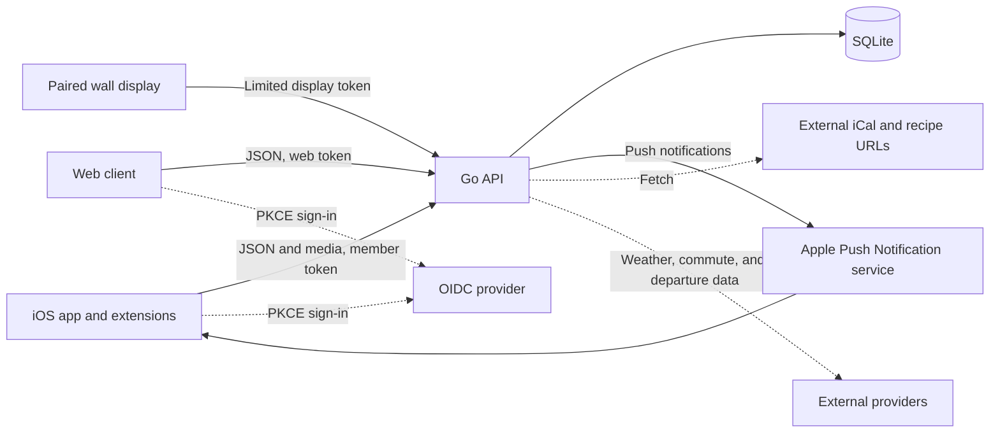
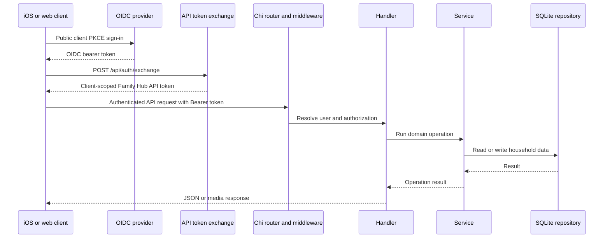

# Architecture

> System design, components, and request flows for Family Hub.

## Overview

Family Hub has a Go JSON and media API backed by SQLite, a native SwiftUI app,
and a separately deployed Next.js web client. Both clients use the shared API
and household data. A paired wall display uses a revocable, limited credential
instead of a member account token.

## Diagram

## Components

| Component | Responsibility | Location |
|-----------|---------------|----------|
| Go API | Chi router, authentication, JSON and media routes | `server/internal/server/`, `server/internal/handlers/` |
| Services | Business rules, recurrence, assignments, external URL guards, provider clients | `server/internal/services/` |
| Repositories | Interfaces and SQLite data access | `server/internal/repository/` |
| Database | SQLite connection and startup migrations | `server/internal/database/` |
| iOS app and extensions | Native household client, widgets, Watch app, and shared models | `ios/` |
| Web client | Responsive member app and paired wall display | `web/` |

## Member request flow

The iOS app and web client each run their own public OIDC PKCE flow. The web
client exchanges its OIDC bearer at `POST /api/auth/exchange?client=web`. The iOS
app mirrors its server URL and long-lived API token into the shared app group
for extensions. The web client uses a web-scoped API token. Admin routes also
require the admin role. The API does not serve HTML or create browser sessions.

Wall displays are paired by an authenticated admin through the iOS app. The
server issues a separate display credential for each display. Display routes
restrict access to household data and supported display actions; revoking the
display does not revoke the pairing user's account.

Public API routes are `/health`, `/api/client-config`, and the OIDC token
exchange. Other member routes require a Family Hub Bearer token. See the
[endpoint reference](endpoints.md) for the full route list and caller access.

## External URL guard

Handlers that fetch user-provided URLs, including iCal subscriptions and recipe
imports, use `services.ValidateExternalURL` and
`services.NewSafeHTTPClient` in `services/safenet.go`. This blocks private IP
ranges and non-HTTP(S) schemes.

## Data and client state

SQLite is the system of record for household data. Database migrations run
during server startup. The iOS app uses SwiftData as a cache and does not
support offline writes. The web client stores its web token in browser local
storage. Display credentials have a separate scope from member tokens.

## External dependencies

| Service | Purpose | Failure mode |
|---------|---------|--------------|
| OIDC provider | Sign-in for iOS and web clients | Sign-in and token exchange fail |
| External iCal feeds | Calendar subscriptions | Feed refresh fails; previously stored events remain |
| Recipe URLs | Recipe import | Import returns an API error |
| Open-Meteo | Weather data | Weather becomes unavailable |
| National Rail provider | Commute departures | Train results become unavailable |
| Google Maps APIs | Home departure estimates | Departure estimates become unavailable |
| Apple Push Notification service | Chore reminders and family broadcasts | Push delivery fails or remains pending |

## Key decisions

- **Separate clients, shared API.** The web app is deployed separately from the
  Go API; both clients use the same server installation and shared data.
- **Scoped credentials.** Member, web, and display credentials have distinct
  access. A display credential cannot call member or admin routes.
- **Public PKCE OIDC clients.** No client secret is stored in the server or
  browser build.
- **Pure-Go SQLite.** `modernc.org/sqlite` removes the CGO toolchain dependency;
  tests use in-memory databases.
- **No offline writes on iOS.** SwiftData is a cache; mutations require
  connectivity.
- **Repository → Service → Handler.** Handlers avoid direct repository access
  when business logic belongs in a service.
- **Migrations run on startup.** Deployment does not require a separate
  migration step.
