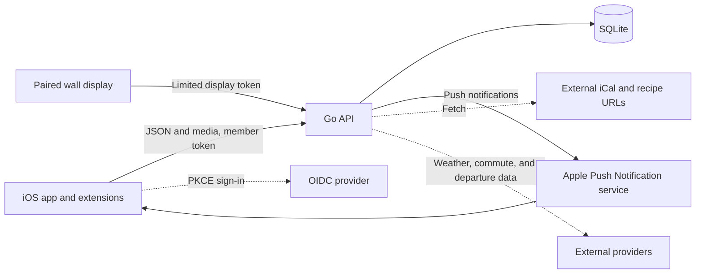
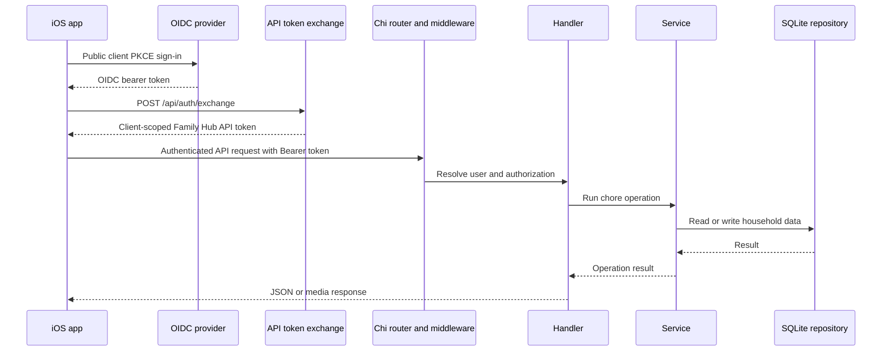

# Architecture

> System design, components, and request flows for Family Hub.

## Overview

Family Hub has a Go JSON and media API backed by SQLite, a native SwiftUI app,
and a separately deployed Next.js wall display. Admins pair and configure each
display in iOS. Each paired display uses its own limited, revocable credential.

## Diagram

## Components

| Component | Responsibility | Location |
|-----------|---------------|----------|
| Go API | Chi router, authentication, JSON and media routes | `server/internal/server/`, `server/internal/handlers/` |
| Chore application | Chore operations, transaction and storage ports | `server/internal/application/chores/` |
| Chore domain | Resolution, recurrence, overdue and assignment rules | `server/internal/domain/chores/` |
| Household applications | Meal, inventory, shopping, scratchpad and home settings operations and storage ports | `server/internal/application/` |
| Household domain | Inventory, shopping, scratchpad and home settings rules | `server/internal/domain/` |
| Integration applications | Calendar, recipe import, weather, rail and departure operations | `server/internal/application/calendar/`, `recipes/`, `commute/`, `weather/` |
| Pairing and broadcasts | Challenge operations and broadcast delivery ports | `server/internal/application/displays/`, `notifications/` |
| Services | Reminder workflows, external URL guards and provider clients | `server/internal/services/` |
| Repositories | SQLite adapters and interfaces for other features | `server/internal/repository/` |
| Database | SQLite connection and startup migrations | `server/internal/database/` |
| iOS app and extensions | Native household client, widgets, Watch app, and shared models | `ios/` |
| Web client | QR pairing state and household wall display | `web/` |

### Backend ports and adapters

The chore application exposes operations for creation, resolution, definitions,
forecasting, and assignment. HTTP handlers and the overdue worker call those
operations. The application defines the storage and transaction interfaces in
`server/internal/application/chores/ports.go`. SQLite adapters implement them in
`server/internal/repository/`; startup connects them in `server/internal/server/`
and `server/main.go`. A timezone function is injected at startup.

Chore completion and skipping use immutable resolution transitions. Recurrence,
overdue checks, and assignee rotation use domain rules in
`server/internal/domain/chores/`. A transaction groups chore, assignment, and
series writes. Shared tests exercise the in-memory fake and SQLite adapters,
including rollback, concurrent completion, recurrence and rotation.

Meals, inventory, shopping, scratchpad, and home settings also use feature-owned
application operations and storage interfaces. Their HTTP handlers call those
operations and SQLite implements the storage interfaces. Inventory stock changes
use a compare-and-swap update so concurrent changes are not lost. Shopping
restock commits its shopping and inventory changes in one SQLite transaction.
Shared fake and SQLite contracts cover stock changes and shopping restocks.
Calendar feed caching and range selection use a storage port and a feed port;
the iCal adapter provides safe HTTP fetching and parsing. Rail and weather
operations own their caches and call provider interfaces. Departure estimates
use calendar and driving interfaces. Startup connects these operations to the
SQLite and external provider adapters. Application tests use provider fakes;
existing HTTP and provider tests cover the adapters. Calendar subscription
administration uses an application-owned storage interface. Recipe import owns
the fallback order and calls source and parser ports; the recipe adapter keeps
URL validation, HTTP fetching, and format parsing. Shared contracts cover the
calendar store and core recipe import cases.

Display pairing operations generate credentials through injected functions and
use a storage port. The SQLite claim transaction writes the display, token, and
challenge state together. Broadcast operations prepare and claim delivery state
before invoking the APNs sender. Shared fake and SQLite contracts cover
concurrent claims, and tests cover rollback and send ordering.

Some features still use shared model types, and some handlers call repositories
directly, including recipe CRUD and display settings. Identity exchange and
reminder workflows remain in the older structure.

## Member request flow

The diagram above shows the chore operation path. Other features can take
different paths.

The iOS app runs the public OIDC PKCE flow and mirrors its server URL and
long-lived API token into the shared app group for extensions. Admin routes
also require the admin role. The API does not create browser sessions. An optional developer setting serves
the API explorer.

Wall displays are paired by an authenticated admin through the iOS app. The
server issues a separate display credential for each display. Display routes
restrict access to household data and supported display actions; revoking the
display does not revoke the pairing user's account.

Public API routes are `/health`, `/api/client-config`, and the OIDC token
exchange. Other member routes require a Family Hub Bearer token. See the
[endpoint reference](endpoints.md) for the full route list and caller access.

## External URL guard

Handlers that fetch user-provided URLs, including iCal subscriptions and recipe
imports, use `services.ValidateExternalURL` and
`services.NewSafeHTTPClient` in `services/safenet.go`. This blocks private IP
ranges and non-HTTP(S) schemes.

## Data and client state

SQLite is the system of record for household data and per-display section
settings. Database migrations run during server startup. The iOS app uses
SwiftData as a cache and does not support offline writes. The wall display
stores its own token and a read-only data snapshot in browser local storage.
Display credentials have a separate scope from member tokens.

## External dependencies

| Service | Purpose | Failure mode |
|---------|---------|--------------|
| OIDC provider | Sign-in for iOS | Sign-in and token exchange fail |
| External iCal feeds | Calendar subscriptions | Feed refresh fails; previously stored events remain |
| Recipe URLs | Recipe import | Import returns an API error |
| Open-Meteo | Weather data | Weather becomes unavailable |
| National Rail provider | Commute departures | Train results become unavailable |
| Google Maps APIs | Home departure estimates | Departure estimates become unavailable |
| Apple Push Notification service | Chore reminders and family broadcasts | Push delivery fails or remains pending |

## Key decisions

- **Display-only web client.** The web app is deployed separately from the Go
  API and serves only pairing and the paired wall display.
- **Scoped credentials.** Member and display credentials have distinct
  access. A display credential cannot call member or admin routes.
- **Public PKCE OIDC client.** No client secret is stored in the server.
- **Pure-Go SQLite.** `modernc.org/sqlite` removes the CGO toolchain dependency;
  tests use in-memory databases.
- **No offline writes on iOS.** SwiftData is a cache; mutations require
  connectivity.
- **Chore ports and adapters.** The chore application owns storage interfaces;
  SQLite provides their implementation.
- **Migrations run on startup.** Deployment does not require a separate
  migration step.
