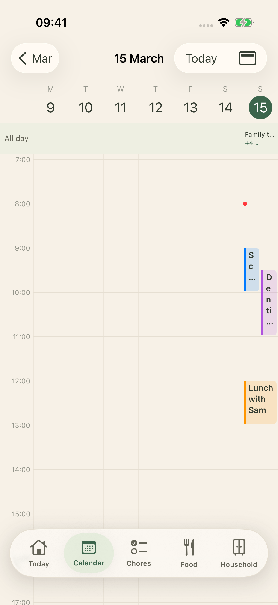
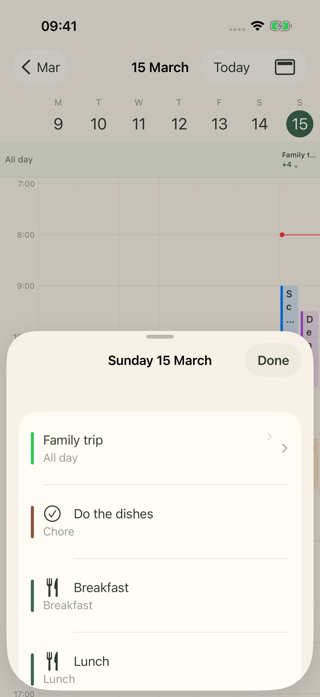

# Calendar and widget proposals

21 October 2026. iPhone only. [Open the gallery](index.html). [Calendar board](calendar-overview.png). [Widget board](widget-overview.png).

These images document the approved designs. The editable layouts use HTML and CSS. The app and widget extension now use native SwiftUI. Simulator captures and implementation checks appear below.

## Native iPhone captures

These captures show the implemented Week layout on an iPhone 17 Pro simulator with iOS 26.5. The expanded sheet scrolls through all five items. The UI test checks the event, chore, breakfast, lunch, dinner, and return to the same week.

## Calendar

**Selected Week refinement: [compact all-day](../week-options/index.html#week-compact).** Keep the seven-day timeline. A single row replaces the expanded all-day area. Tap the count to inspect the full list.

Keep the current views and interactions. Apply the merged Warm Sage Cosier palette from `AppTheme.swift`.

| Existing view or state | Proposed treatment | Behaviour to retain |
|---|---|---|
| Year | Cream canvas, sage year and month headings | Twelve months in three columns. Tap a month. Scroll between years. |
| Month | Warm canvas, restrained lines, sage Today circle | Scroll between months. Tap a date to open Day. Pinch to change density. |
| Month zoom | The same label chips, overflow counts, and expanded cells | Keep the existing scale range. The expanded sample shows a scrolled position. |
| Day | Warm canvas, sage date selection, soft event fills | Keep the week strip, all-day area, time axis, event geometry, and horizontal swipe. |
| Week | The same seven columns and overlap geometry | Keep the narrow columns. Tap a date for more detail. Do not replace Week with an agenda at standard text sizes. |
| View menu | A native-style menu with sage selection | Keep Year, Month, Day, and Week. Keep Today and Back. |
| Large text | The current date picker and agenda fallback | Month opens the selected day’s agenda. Week continues through the week vertically. |
| Event detail | Carry forward the merged event cards | Keep date, location, departure, full details, Maps, and Back. Do not show an arrival margin. |
| Empty and load error | Quiet text and the existing Retry strip | Keep navigation available. Keep saved items when a refresh fails. |

The proposal changes the app colours, not the information architecture. It adds no Calendar mode, event editor, search control, filter, or custom tab. The current-time marker stays red and remains limited to Today’s column in Week.

Calendar source colours remain distinct. The sample uses blue, purple, and amber calendars. User calendar colours must remain user calendar colours. Meals use sage fills. Chores use warm clay fills. Symbols and labels distinguish the item types.

The source month and timeline views intentionally use small labels at dense zoom levels. The implementation retains that density. The existing agenda fallback supports large text. The compact Week sheet and navigation were checked on the iPhone simulator. Physical-device font metrics, zoom, and VoiceOver still need a release check.

## Widget proposal

Recommend **Today medium** as the default. Put the next timed event beside dinner. Keep the chore count secondary. Use **Today large** for the fuller day and direct chore completion.

| Choice | Families | Main question | Tap behaviour |
|---|---|---|---|
| Today | Medium, large | What is next, and what is for dinner? | Event area opens Calendar. Meal area opens Meals. The background opens Today. |
| Tonight | Small | What is for dinner? | The whole widget opens Meals. |
| Meal plan | Medium | What are today’s meals? | Meal rows open Meals. Dinner has emphasis. |
| Up next | Small | When and where is the next event? | The whole widget opens Calendar. |
| Chores | Small, medium | What needs attention? | Small opens Today. Medium has separate completion circles and row links. |
| Lock Screen meal | Inline | What is for dinner? | Opens Meals. |
| Lock Screen event | Rectangular | What is the next event? | Opens Calendar. |
| Lock Screen chores | Circular | How many chores remain? | Opens Today. |

The meal symbol is a generic meal marker. It does not claim that a recipe link or image exists. The plan shows today’s meals. It does not invent a meal time or replace the app’s Friday–Thursday plan.

The widget shows event start times, not departure estimates. It shows outstanding chore counts, not a completion percentage. Current data cannot supply a trustworthy completion denominator.

Medium and large links use the existing `familyhub://calendar`, `familyhub://meals`, and `familyhub://today` destinations. These routes do not select a specific event, recipe, or meal row. Small widgets and Lock Screen accessories use one destination each.

### Interaction and data requirements

- Keep chore completion as a separate button from the row link. Use a 44-point action area in Home Screen widgets.
- Keep the task until the server confirms completion. A failure keeps the task unchecked. The widget shows pending and failed states through shared intent and provider state.
- Cached data carries its saved time. Do not run a stale countdown. Do not allow a cached completion action to imply success.
- An unavailable hub with no saved data shows a connection state. It does not show an empty day.
- A signed-out widget opens the app to sign in. An empty day and an unplanned dinner have distinct messages.
- Long names wrap. Large text shows fewer items instead of shrinking every label.
- Event and meal titles use WidgetKit privacy redaction. The app has no separate privacy setting.

The widget snapshot carries absolute event dates and an all-day flag. “Up next” skips all-day and past events. Timeline entries refresh at event boundaries within WidgetKit’s update budget.

The Today presentation selects the next event and dinner separately from chores. The implementation preserves the current widget kind for existing installations. Focused widget choices use stable kind identifiers.

The implementation keeps the existing Today widget identifier and adds stable identifiers for Tonight, Meal plan, Up next, and Chores. The shared snapshot carries absolute event dates and separate event and chore rows. The widgets use the existing Today, Calendar, and Meals routes. Widget chore failures remain visible until the app refreshes or a later completion succeeds. Event and meal titles use WidgetKit privacy redaction; the app has no extra privacy switch.

### Appearance and dimensions

Full-colour widgets use the app’s light and dark tokens. Tinted and clear samples show intent. WidgetKit owns the final material and tint. Keep accent and primary content separate. Avoid extra glass panels inside the widget. The reduced-transparency sample uses a solid surface.

Home Screen examples use a 430 × 932-point iPhone: small 170 × 170, medium 364 × 170, and large 364 × 382 points. The small-iPhone medium sample uses 321 × 148 points. Lock Screen examples use 76-point circular, 172 × 76-point rectangular, and 257 × 26-point inline families. These sizes follow [Apple’s widget guidance](https://developer.apple.com/design/human-interface-guidelines/widgets).

The Home Screen and Lock Screen images use an original CSS wallpaper and schematic system chrome. They show placement and scale. They are not SpringBoard or WidgetKit captures. System tint, reduced transparency, and VoiceOver require native verification.

## Source and validation

The review contains 43 images: 16 Calendar proposals and 27 widget, state, appearance, and context proposals. All images render at 3×. The [manifest](manifest.json) records their sizes and descriptions. The [validation result](validation.json) records the file and browser checks.

Edit [mockups.js](source/mockups.js) and [mockups.css](source/mockups.css). Render with `node source/render.cjs`. The renderer accepts `PLAYWRIGHT_MODULE` and `CHROME_PATH` overrides. Build the gallery with `python3 source/build_gallery.py`.

Run `node source/validate.cjs` to check the gallery, layouts, image links, search, group filter, and widget footer separation. The Calendar viewport intentionally clips content that continues below the visible area. Native scrolling is not simulated.

The existing Calendar views and widget source supplied the inventory. The earlier audit supplies four [layout references](../implementation/index.html). The compact Week row and sheet were captured in the iPhone simulator. Widget families were build-checked; their gallery remains a static proposal.

### Apple references

- [Widgets](https://developer.apple.com/design/human-interface-guidelines/widgets): size families, legibility, margins, and content hierarchy.
- [Accented rendering and Liquid Glass](https://developer.apple.com/documentation/widgetkit/optimizing-your-widget-for-accented-rendering-mode-and-liquid-glass): system tint, primary and accent groups, and image treatment.
- [Widget interactivity](https://developer.apple.com/documentation/widgetkit/adding-interactivity-to-widgets-and-live-activities): buttons and toggles through App Intents.

The design also uses the local Apple Design and UI/UX Pro Max skills. Their motion and layout guidance informs the proposal. Static images do not validate motion or physical interaction.
