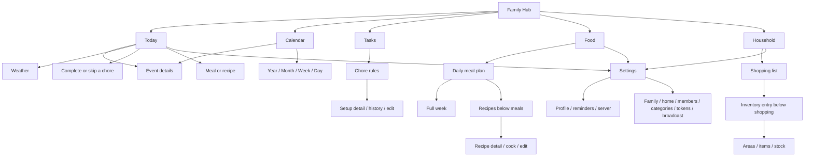
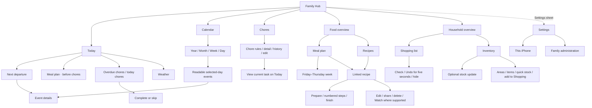

# Navigation maps

The maps show iPhone navigation. Settings is a sheet, not a sixth tab.

## Current

## Proposed

## Navigation rules

- Use the chosen overview screens for Food and Household. Replace inner navigation segments with rows and normal Back actions.

- Keep five top-level tabs. Use Chores for the tab and the screen title.
- Keep completion on Today. Link the current task to Today from its rule detail.
- Keep Meal plan and Recipes as destinations within Food.
- Keep Shopping and Inventory as destinations within Household.
- Preserve the selected meal date, week, and in-tab context when users open details and return.
- Open a linked recipe from the main planned-meal row. Keep Edit meal available through a visible secondary action.
- Keep all existing settings and admin-only access rules.
- Use native back navigation and native sheets. Preserve tab visibility for ordinary detail navigation.
- Keep share, source links, photo selection, optional Watch actions, and destructive confirmations in their existing contexts.
